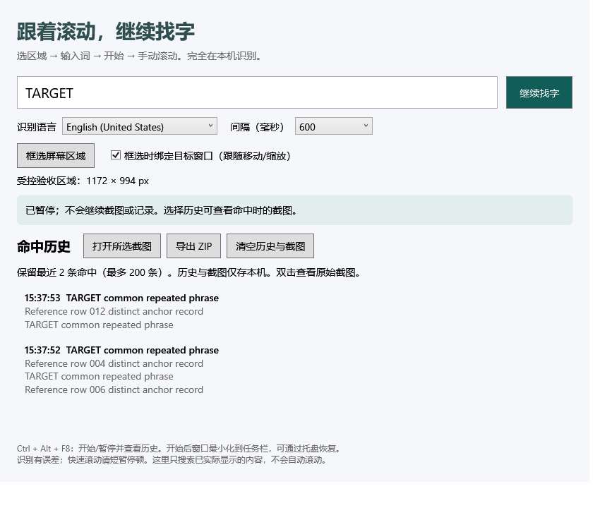

# 跟着滚动的屏幕找字器 · ScrollScreen Search

在网页、扫描 PDF、图片或普通软件里框选一块区域，输入关键词，自己滚动；程序持续识别当前画面，标出匹配位置，并留下带上下文和截图的命中历史。

适用于 Windows 10 2004（19041）及更新的 Windows 11，x64。**OCR、截图和历史都在本机处理，不上传，不需要账号或 API 密钥。**



## 直接使用

1. 下载发行包 `ScrollScreenSearch-win-x64.zip`，解压整个目录。
2. 双击 `ScrollScreenSearch.exe`。自包含发行包无需另装 .NET。
3. 选择本机可用的 OCR 语言，输入要找的词。
4. 点击「框选屏幕区域」，在目标内容上拖一个矩形。`Esc` 取消。
5. 点击「开始找字」，控制窗口自动最小化。手动滚动目标内容，并在想识别的位置短暂停顿。
6. `Ctrl + Alt + F8` 暂停/继续；恢复主窗口也会暂停。双击历史查看原始截图及命中框。

任务栏和系统托盘均可恢复控制窗口。托盘菜单提供暂停、继续和退出。若快捷键被占用，主界面会提示，可使用托盘操作。

「框选时绑定目标窗口」会按目标窗口的物理位置与大小跟随区域；勾选状态作用于下一次框选。取消勾选则固定在屏幕坐标。框选跨越多个窗口时建议取消绑定。绑定目标被关闭、最小化或移出桌面时程序暂停并说明原因。

## 功能与边界

- **中文和英文：** 使用 Windows 已安装的 OCR 语言。下拉框只列出真实可用的语言；每次选择一种语言。缺少语言时，在 Windows「设置 → 时间和语言 → 语言和区域」添加该语言及文字识别功能，然后重启本程序。
- **匹配：** 普通文本子串，忽略大小写、空白与全角/半角差异。不支持正则、跨行短语或语义搜索。高亮按 OCR 单词边界绘制；中文的一个 OCR 单词可能包含多个字。
- **连续搜索：** 单任务节流，不并发堆积 OCR。画面变化明显时等待稳定；快速滚动、视频、闪动动画、低清小字会影响识别。实际间隔由 OCR 耗时和设置共同决定。
- **去重：** 利用前后帧重叠文字的位置估计滚动量，区分不同位置的相同文字。没有可靠重叠时宁可保留一条标记「位置未关联」的命中。完全相同、无锚点的不同页面无法可靠区分；跳页可能产生重复。换文档请重新框选。
- **历史：** 保存最近 200 条命中及所需截图；截图包含选区内的完整画面。超出时自动移除较旧记录与不再使用的截图。当前运行的去重缓存最多保留约 10,000 个位置，重新启动后重新建立滚动关联。
- **导出：** ZIP 包含 CSV、JSON 和截图，相对路径可移植。CSV 对公式前缀转义。JSON 中 `Bounds` 使用原始截图物理像素坐标。
- **截图方式：** 捕获实际可见的屏幕像素，不读取被遮挡窗口内容。其它窗口遮住目标时读到的是遮挡后的画面。开始时控制窗口最小化；高亮层在每次捕获前隐藏，并设置排除捕获属性。
- **不会自动滚动，也不会搜索尚未显示过的内容。** 暂停后不继续捕获；已经在系统 OCR 中的工作可能稍后结束，但结果会被丢弃。
- 不支持安全桌面、受保护的视频、锁屏后台识别；远程桌面和混合缩放多显示器尚未完成实机矩阵测试。

## 数据位置

数据保存在 `%LOCALAPPDATA%\ScrollScreenSearch\`，包含 `settings.json`、`history.json` 和 `screenshots\`。程序关闭后仍会保留。点击「清空历史与截图」可删除历史资料；删除整个目录可重置全部配置。

导出前请自行检查选区截图是否包含不想分享的内容。仓库忽略历史、测试截图目录和本地发行目录，仅文档中的合成测试界面截图进入版本控制。

## 从源码构建

需要 Windows、.NET SDK 8.0，以及构建时访问 NuGet 的网络连接；使用不依赖第三方测试框架的控制台测试程序。

```powershell
dotnet build src/ScrollSearch.App/ScrollSearch.App.csproj -c Release
dotnet run --project tests/ScrollSearch.Tests -c Release
.\scripts\build.ps1
```

`scripts/build.ps1` 先运行核心测试，再生成 `dist/ScrollScreenSearch-win-x64.zip`。指定隔离 SDK：

```powershell
.\scripts\build.ps1 -Dotnet C:\path\to\dotnet.exe
```

真实屏幕验收会创建自己的受控文本窗口，短暂执行拖动框选和全局热键测试；请在不操作键鼠时运行。只截图测试窗口内部，不捕获整个桌面。

```powershell
.\dist\win-x64\ScrollScreenSearch.exe --self-test --output .\artifacts\acceptance
```

结果写入 `acceptance.json`，进程成功退出码为 0。该验收依赖交互式 Windows 桌面和英文 OCR；若安装中文 OCR，也会实际测试中文识别。CI 执行核心测试和 Windows 构建，不把无交互桌面的 CI 当作真实 OCR 验收。

详见 [测试与验收报告](TEST_REPORT.md)、[依赖声明](THIRD_PARTY_NOTICES.md)。自有代码使用 [MIT](LICENSE) 许可证。
